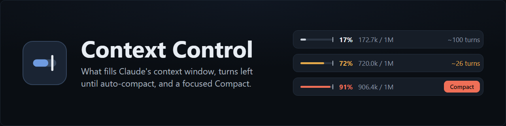
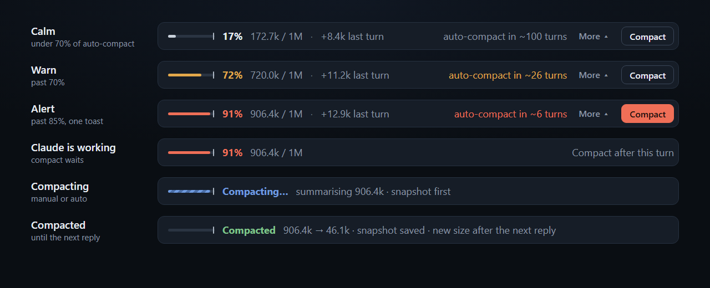

# Context Control: context window meter and Compact for Claude Code

<p align="center">
  <a href="LICENSE"></a>
  
  
</p>

<p align="center">
  <a href="#install">Install</a> ·
  <a href="#what-it-does">What it does</a> ·
  <a href="#comparison">Comparison</a> ·
  <a href="#settings">Settings</a> ·
  <a href="#what-it-reads-sends-and-writes">Privacy</a> ·
  <a href="#faq">FAQ</a> ·
  <a href="CHANGELOG.md">Changelog</a>
</p>

Context Control is a Claude Code mod that keeps your **context window** in view. A band above the prompt shows your **context usage** as you work: how full the window is, how many **tokens** each turn adds, what fills it, and how many turns are left until **auto-compact**. When you want to **compact**, a Compact button takes a focus, so the summary keeps what matters. It works in the Claude desktop app's Code tab and in the terminal.

> Unofficial community mod. Not affiliated with or endorsed by Anthropic.

## What it does

- **Band above the prompt.** Fill bar, percentage, tokens / window, growth last turn and turns left until auto-compact. Click anywhere on it (or the ▲ arrow) for the breakdown, which opens in short stages from the strip: the window with the auto-compact marker, what fills it by category, last turn, average per turn. Click anywhere on the breakdown, or ▼, to close it. It never scrolls: when the band is short, it drops spacing and its lowest legend rows first.
- **Compact with focus.** **Compact** opens a field for what the summary must keep, then runs the same compaction `/compact` does. While Claude is working it waits for the turn to end.
- **Alerts.** The band turns amber, then red, as you approach auto-compact (70% and 85% of the threshold by default), and one toast fires when you cross the alert line.
- **Side pane** (the ↗ icon on the band, or `/context-control`): context over the session with compaction markers, what fills it, what is loaded on every turn (MCP servers, memory files, skill listing, agents) and compaction history.
- **Pre-compact snapshot** (off by default): before any compaction, manual or auto, writes a Markdown handoff of recent prompts, files touched and open tasks.

The bars animate as the numbers change: fill grows, the session chart draws in, the band breathes at the alert level and shimmers while compacting.



<sub>Illustrative mockup of the band's states, with sample figures.</sub>

## Comparison

What Claude Code shows on its own, and what Context Control adds.

| | Claude Code built in | Context Control |
| --- | --- | --- |
| Context usage always in view | Depends on the app version; some desktop builds show no context indicator, and the terminal needs a custom status line | A band above the prompt |
| What fills the context window | `/context`, on demand | Live, by category, plus what is loaded on every turn |
| Turns until auto-compact | Not shown | Estimated from recent growth |
| Warning before auto-compact | A notice near the limit | Amber, then red, and one toast |
| Compact with a focus | Type `/compact <instructions>` | A Compact button with a focus field that waits for the turn to end |
| Snapshot before compaction | Write your own PreCompact hook | Built in, optional |
| Context over the session and compaction history | Not shown | Side pane |

## Install

In a terminal Claude Code session:

```
/plugin install context-control --marketplace AweGuider/Claude-Context-Control
```

Answer `y` to add the marketplace, then pick the user scope. Or, from your shell:

```
claude plugin install context-control --marketplace AweGuider/Claude-Context-Control
```

Installed at user scope, it loads in every new session, including the Claude desktop app's Code tab. In a session that is already running, type `/reload-plugins`.

**Update:** `claude plugin update context-control@awedev`, then `/reload-plugins`, or press **Update** on the plugin's page in the desktop app.
**Uninstall:** `claude plugin uninstall context-control@awedev`.

Built against Claude Code 2.1.295. The mod API is early access and can change between releases.

## Settings

In the pane's **Settings** tab; saved across sessions.

| Setting | Default |
| --- | --- |
| Band above the prompt | On |
| Band starts | Collapsed |
| Open the pane when a session starts | Off |
| Name the band's ↗ and ▲ icons on hover | On |
| Warn at / Alert at | 70% / 85% of auto-compact |
| Toast once when crossing Alert | On |
| Average over (for turns left) | 5 turns |
| Exact counts | Off |
| Pre-compact snapshot | Off |
| Keep snapshots out of git | On |

## Snapshots

When on, each compaction first writes `.claude/context-snapshots/<date>_<time>.md` in the session's working directory (normally the project root) with the trigger, model, context size, the focus you gave, your last 10 prompts, files edited and read, and open tasks. The folder is fixed. With **Keep snapshots out of git** on, the mod also writes `.claude/context-snapshots/.gitignore` containing `*`, a file git reads to ignore the snapshots; your project's own `.gitignore` is not touched. Old snapshots are not deleted.

## What it reads, sends and writes

- **Reads** the session's own usage figures (context fill, window size and the breakdown by category), the session's id and prompt count, and, only for a snapshot, the session's transcript.
- **Sends** nothing by default: no network requests, no model calls, no telemetry. With **Exact counts** on (off by default), the breakdown uses Claude Code's own token-count requests, one per tool and memory file, as `/context` does, to the Anthropic API your session already uses.
- **Writes** its settings and each session's context size per turn (token counts only, the 20 most recent sessions) through Claude Code's plugin storage and, only with snapshots on, two kinds of file in `.claude/context-snapshots/` under the working directory: the snapshot Markdown files and, with **Keep snapshots out of git** on, a `.gitignore` that tells git to ignore that folder. It writes no other file.
- **Hooks compaction** (`session.compact`) only to save the snapshot first and to record the compaction in its history. It passes every compaction on unchanged and never delays, edits or blocks it.
- **Adds one command**, `/context-control`, which opens the mod's pane and does nothing else.

The full policy is in [PRIVACY.md](PRIVACY.md).

## FAQ

### How do I see how much context Claude Code is using?

Install Context Control. The band above the prompt shows the context window's fill as a bar and a percentage, the tokens used out of the window, and how much the last turn added. Click it for the breakdown, or run `/context-control` for the pane.

### Where did the context indicator and Compact button go in the Claude desktop app?

Some versions of the desktop app don't show a context indicator or a Compact button above the prompt. Context Control adds both back as a mod, with more detail: what fills the context and how many turns are left until auto-compact.

### How many turns do I have until Claude Code auto-compacts?

The band shows it, estimated from the average growth of your last five turns (adjustable in Settings) against the auto-compact threshold. The expanded band and the pane mark that threshold on the bar.

### What is taking up my context window, and how do I free some?

The breakdown splits the context into messages, system prompt, system tools, MCP tools, skills, agents and memory files. The pane's **Always loaded** list ranks what you pay for on every turn, such as MCP servers and CLAUDE.md files, so you can see what to disconnect or trim.

### How do I compact without losing important details?

Press **Compact** and write what the summary must keep, such as "the plan and the open bugs". It runs the same compaction as `/compact <instructions>`. Turn on the pre-compact snapshot to also keep a Markdown handoff on disk.

### Does it work in the terminal, VS Code and the desktop app?

The band appears in the Claude desktop app's Code tab and in the terminal. The pane opens on every surface Claude Code draws on; VS Code is untested.

### Does it send my data anywhere or use API credits?

No. It makes no network requests and no model calls. The optional **Exact counts** setting uses the same token-count requests as `/context`; it's off by default.

### Does it write anything to my disk?

Only its settings and recent sessions' context sizes (both in Claude Code's plugin storage), and snapshots if you turn them on. Snapshots go to `.claude/context-snapshots/` in your project, with a `.gitignore` there that keeps them out of git.

### How do I update or uninstall it?

See [Install](#install). Updates arrive when the version changes; press **Update** on the plugin's page or run `claude plugin update context-control@awedev`.

### Is it official?

No. Context Control is an unofficial community mod by AweDev, not affiliated with or endorsed by Anthropic.

## Limitations

- Where an organization manages Claude Code, hooks on compaction run only for plugins the organization lists, so snapshots and the compaction history record only the mod's own Compact button there.
- Claude Code reports no token count until a session's first reply, so until then the band shows the breakdown's own estimate, marked `~`. The same applies to the average per turn of a session with no history yet: it is estimated from message tokens over prompts sent, and reads low after an earlier compaction.
- **Last turn** shows `—` after the mod missed turns (installed or updated mid-session), until the next reply.

## Development

```
claude plugin validate .
claude plugin test .
claude --plugin-dir .
```

`hooks/register.tsx` holds the hooks and drawings, `hooks/model.ts` the figures, `hooks/svg.ts` the bars and chart, `hooks/snapshot.ts` the snapshot writer, `types/index.d.ts` the state contract and `tests/control.test.ts` the tests.

## License

MIT © 2026 Alan Safonov (AweDev)
